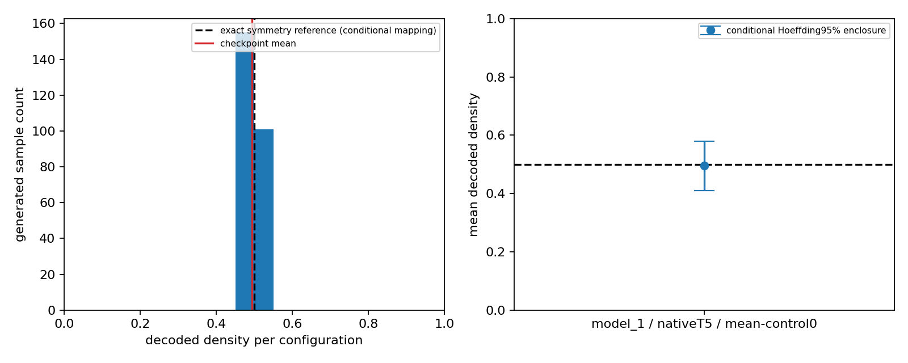

# ExpTM author-code reproduction v1

**Strongest outcome: author checkpoint execution verified, with one limited quantitative density diagnostic. Full published-result reproduction remains UNRESOLVED.**

## Source, selected workflow and scope

Pinned [tiwarylab/ExpTM](https://github.com/tiwarylab/ExpTM/tree/28f1252eed7cbaaf67d901b337ffee1885552fbe) at `28f1252eed7cbaaf67d901b337ffee1885552fbe`. Actual application directory is `GC_Lattice_gas/expTM_data_genenration`; its spelling is retained. Core `tm/` is present. README's root installation path is not an existing complete environment. CO2 assets and the Colab link exist, but neither application nor remote Colab ran. The older thermomaps-ising and later HOOMD tutorial were not substituted.

We executed the authors' lattice-gas preprocessing/sampling recipe from GC_ising_code.ipynb cells1–7 and9–10 through a small local runner, replacing training cell8 with supplied checkpoint loading. No author source code was patched. All source/data/checkpoint bytes are Git-blob and SHA-256 verified. License metadata is null and no LICENSE file is present; setup.py advertises an MIT classifier but a complete repository license was not recovered. See SOURCE_PIN_AND_LICENSE.json.

| Outcome | Established? |
|---|---|
| CPU environment installed | Yes; Python3.12 / torch2.5.1+cpu; exact dependencies supplied |
| Selected code executes end to end | Yes;100-step smoke,2 finite20×20 outputs |
| Author checkpoint evaluated | Yes; model_1.pt, strict3-channel dim32 load |
| Published Fig2 result reproduced | **Unresolved configuration/reference binding** |
| Independent retraining reproduced | No;0 new optimizer updates |
| Generalization / total efficiency demonstrated | No |

## One frozen comparison

The intended paper link is the symmetry-center density in Fig2(b), physical μ=−8 and intendedT=5. We actually evaluated literal author notebook controls `temperature=5, pressure=0`. The normalized mean-control endpoints are−1/+1; interpreting zero as the physical symmetry center is plausible from the stated anchors but is not a recovered figure-run binding.

Original data contain5000 configurations per supplied anchor, shape(5000,2,20,20), float64, spin-like values±1 and stored label±4. The literal notebook prepares(10000,3,20,20): spin,temperature5,normalized mean-control−1/+1. Author dequantization0.01,dim32 U-Net,nearest-exact20↔32 interpolation,polynomial100-step VP diffusion,eta1,gamma1 and zero-threshold occupancy decoding were retained. Model-level self_condition is its defaultFalse; backbone self_condition=True/eval_mode=train is preserved. Only one condition was generated, with locally frozen seeds; no hyperparameter or checkpoint performance search.

For the intended periodic lattice-gas Hamiltonian, complementing every occupancy at μ=−εz/2 gives equal equilibrium weight to n and1−n. Thus Eρ=1/2 for any positiveT. This exact physical expectation, not a digitized figure or a guessed MC cell, is the comparison reference. The reference does not resolve checkpoint parameter units or validate a learned distribution merely by its mean.

## Actual quantitative output

| Quantity | Result |
|---|---:|
| Generated configurations |256, all finite and retained|
| Output array shape |(256,3,20,20)|
| Mean decoded density |0.49472656249999997|
| Exact symmetry reference, conditional mapping |0.5|
| Absolute difference |0.0052734375000000333|
| Sample density SD |0.015776423135831018|
| Descriptive conditional SEM |0.00098602644598943861|
| Prospective conditional Hoeffding95% enclosure |[0.40984521776621125,0.57960790723378874]|
| Distinct decoded configurations |256/256|

The exact reference lies inside the predeclared bounded enclosure. That enclosure is deliberately conservative and **does not certify a small accuracy tolerance**. SEM is descriptive conditional sampling information; no normal-based CI or post-result acceptance threshold was introduced. One fitted checkpoint and one preparation/generation seed provide no retraining uncertainty. Generated configurations, not400 sites, are the sampling units; the bound assumes independent idealized random draws conditional on the fixed model. It is not a physical-reference-history or parameter-mapping uncertainty bound. A correct central mean is a weak test and does not validate correlations, occupancy fluctuations, phase boundaries or thermodynamic transport.

Firstsix draws, prospectively fixed indices, are shown in first_six_generated_lattices.png; all256 densities and raw outputs are saved.

## Why the published target is not yet bound

| Concrete finding | Consequence |
|---|---|
| model49 has4-channel/dim16 weights; strict loading failed | It is incompatible with the specified lattice-gas network. Failure logs are retained; no resizing or new representation. |
| model1 matches3-channel/dim32, epoch1; optimizer steps64 | Real author checkpoint, but not demonstrably the published training run. |
| Current notebooks useT1 orT5; paper trainsT7 | No unverified temperature conversion or scientific correction was invented. |
| Provided data5000+5000; published SI says10000+10000 | The exact training subset for the figure is not recovered. |
| Published supplement specifies10epochs/100 diffusion steps; checkpoint lacks schedule/scaler/seeds |100steps agrees with the public recipe, but training provenance is incomplete. |
| Provided density_heatmap.npy is5×5 without axes/checkpoint/seed bindings | It is not treated as the published MC/generated numerical map. |

The [published Article in Press](https://doi.org/10.1038/s41467-026-77612-y), Results/Fig2 and Methods Eqs18–21, and [published supplement](https://static-content.springer.com/esm/art%3A10.1038%2Fs41467-026-77612-y/MediaObjects/41467_2026_77612_MOESM1_ESM.pdf), Notes1–3/Algorithm1, were inspected along with the README-linked arXiv version. The published calculation uses twoT7 anchors and evaluates density across a two-variable grid. This release tests neither that full grid nor its timing comparison. Different hardware, sample counts and uncharged original training-data acquisition prevent a speedup inference from our CPU timing.

## Cost, handoff and STOP

Quantitative checkpoint execution measured439.31989176000025wall/874.973192322CPU seconds, including preparation/loading; sampling loop alone436.0686283489995wall seconds. Cumulative setup, transfer, failed inspection, smoke, generation, analysis and verification costs are in RESOURCE_LEDGER.json; later publication costs are separate. All computation remains below1800 activewall/7200 aggregateCPU ceilings. GPU0,paidcompute0,clusterjobs0,newtraining0. The initial15s inspection allowance is a labelled conservative budget reserve, not a measurement. Overlapping setup/download costs are conservatively summed; the ledger race was corrected from its exact metering receipt, never by removing costs.

**One justified next step:** obtain the author figure-bound run bundle specifying theT7/10epoch checkpoint, exact control transformations, training-data selection and numeric Fig2 reference arrays. This is a concrete provenance prerequisite before a full result comparison, not permission to retrain or guess a new configuration. No successor is executed.

LEARNING_HANDOFF.md supplies the executed function sequence, shapes, paper links and an optional one-sample rerun. COORDINATION_HANDOFF.md separates technical execution, conditional density evidence and unresolved scientific claims. Historical ABP/CP4/TrackB/C/D decisions and locked Pe7.5/22.5/27.5 roles remain unchanged. This equilibrium-system exercise establishes no activity-to-distribution mapping for interacting ABPs. STOP.
